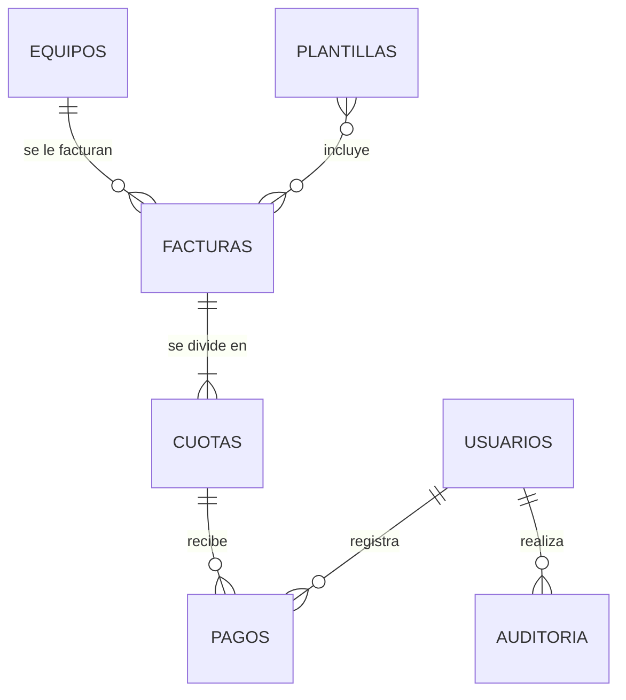

# Modelo de datos

## Relaciones

- Un **equipo** tiene muchas **facturas** (LGARS tiene dos).
- Una **factura** tiene una o más **cuotas** (hoy casi siempre 2).
- Una **cuota** recibe uno o varios **pagos** (permite abonos).
- **Saldo de la factura = valor total − suma de sus pagos.**
- Ninguna relación borra en cascada: no se puede eliminar un equipo con facturas ni una factura con pagos.

## Tablas

### equipos — `equipos_equipo` (hoja Datos, una fila = un registro)

| Campo | Tipo | Origen en Excel | Notas |
|---|---|---|---|
| id | entero | — | Identificador interno (se muestra como EQ-0001) |
| nombre_club | texto | NOMBRE DEL CLUB | Se guarda en mayúsculas y sin espacios sobrantes |
| razon_social | texto | NOMBRE | A quién se factura |
| documento | texto (solo dígitos) | DOCUMENTO | Tercero Externo en World Office |
| digito_verificacion | texto (1) | — | **Nuevo**, opcional |
| valor | decimal | VALOR | |
| cuotas | entero | CUOTAS | |
| descuentos | decimal | DESCUENTOS | |
| seguimiento | Por facturar / Facturado | SEGUIMIENTO | |
| responsable, correo, telefono, direccion | texto | — | **Nuevos**, opcionales, para cobro |
| activo | sí/no | — | Reemplaza la eliminación |
| creado, actualizado | fecha-hora | — | Automáticos |

Calculados (no se guardan): `valor_cuota` = VALOR / CUOTAS; `nota_factura` = texto de configuración + «(club)»; NOVEDADES se calculará desde las facturas.

Regla única: no se repite la pareja (documento, nombre_club). Un club sí puede tener dos pagadores.

### facturas — `facturacion_factura` (Registro Facturas + Pagadas)

| Campo | Tipo | Origen |
|---|---|---|
| id | entero | — |
| equipo_id | → equipos | NIT / CÉDULA |
| prefijo | texto | «FV EF» de N.º FACTURA |
| numero | entero | número de N.º FACTURA (único junto con prefijo) |
| fecha | fecha | FECHA |
| valor_total | decimal | VALOR TOTAL |
| cant_cuotas | entero | CANT. CUOTAS |
| nota | texto | NOTA |
| marcada_para_plantilla | sí/no | FACTURAR = «Facturar» |
| anulada | sí/no | Encab: Anulado |
| creado, actualizado | fecha-hora | — |

### cuotas — `facturacion_cuota`

| Campo | Tipo | Origen |
|---|---|---|
| id | entero | — |
| factura_id | → facturas | — |
| numero | entero | 1 o 2 |
| valor | decimal | VALOR CUOTA 1 / 2 |
| vencimiento | fecha | VENC. CUOTA 1 / 2 |
| link_pago | URL | LINK CUOTA 1 / 2 y hoja WOMPI |

### pagos — `facturacion_pago` (reemplaza las casillas $ y $2)

| Campo | Tipo |
|---|---|
| id | entero |
| cuota_id | → cuotas |
| fecha | fecha |
| valor | decimal |
| medio | Wompi / Transferencia / Consignación / Efectivo / Otro |
| referencia | texto |
| observacion | texto |
| registrado_por | → usuarios |
| creado | fecha-hora |

### plantillas — `facturacion_plantillagenerada`

id, fecha, usuario, facturas incluidas (relación muchos a muchos), consecutivo_inicial, consecutivo_final, nombre_archivo, observacion.

### configuracion — `core_configuracion` (registro único)

Torneo (nombre, año, edición, texto de la nota), encabezado World Office (empresa, tipo documento, prefijo, tercero interno, forma de pago, siguiente consecutivo), detalle World Office (producto, bodega, unidad, IVA, centro de costos) y reglas de cartera (días de aviso, días de vencimiento de cada cuota).

### auditoria — `core_registroauditoria`

id, fecha, usuario, acción, modelo, objeto_id, descripción, cambios (antes/después). No se puede editar ni borrar.

### usuarios — `auth_user`

Tabla estándar de Django: usuario, nombre, correo, contraseña cifrada, grupos y permisos.
